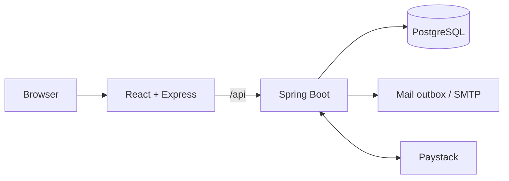
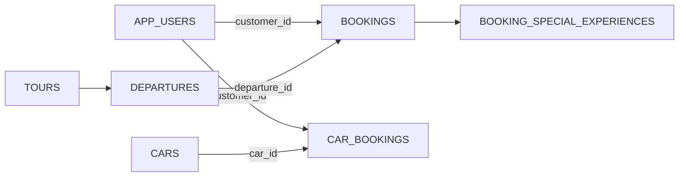
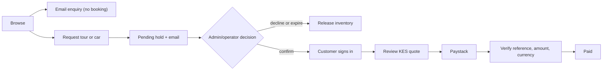
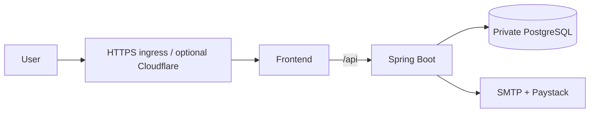

# Wildpath Safari Booking

## 1. Application overview
Wildpath lets customers request safari tours and vehicle rentals, track reservations, and pay for confirmed bookings online. Admins manage the catalog and requests; tour operators can act through secure email links. Customers authenticate with email codes. The footer includes a form for submitting star ratings and review comments.
Demo URL referenced by the sitemap: [safaritours.dpdns.org](https://safaritours.dpdns.org); availability depends on the external deployment. The footer review form stores submitted star ratings and comments in the application database. Screenshots are not included.
## 2. Technology stack
Area
Technologies                                                 
                                                         
Frontend       
React 18, TypeScript 5, Vite, React Router   

Backend
Java 21, Spring Boot 3.5, Spring MVC, Spring Data JPA 

Database
PostgreSQL 16; H2 for E2E 

Infrastructure
Docker, Docker Compose, Hibernate schema generation

Integrations
SMTP, Paystack, Playwright; optional Cloudflare proxy/tunnel 

## 3. Architecture and project structure
The browser loads React from Node/Express; `/api` is proxied to Spring Boot. The API uses JPA with PostgreSQL, queues email through an outbox, runs booking reminder/expiry jobs, and integrates with SMTP and Paystack.

```text
frontend/src/                 React pages, API client, types and styles
frontend/test/, frontend/e2e/ Node unit and Playwright browser tests
src/main/java/.../booking/    Tour booking lifecycle and notifications
src/main/java/.../car/        Vehicle catalog and booking lifecycle
src/main/java/.../payment/    Checkout, verification and webhooks
src/main/java/.../security/   Email-code auth, sessions and roles
src/main/resources/           Spring configuration
```
Controllers expose HTTP APIs; services own workflows and transactions; repositories handle persistence. Pessimistic row locks protect inventory and payment completion.
## 4. Database design
Users own tour and vehicle bookings. Tours have departures; tour bookings reserve guests on a departure. Vehicle bookings reference cars and reserve date ranges. Add-on selections are snapshotted with tour bookings; sessions, login codes, and mail messages are stored separately.

Hibernate creates missing tables and updates the schema from the JPA entity mappings on startup (`spring.jpa.hibernate.ddl-auto=update`). There are no SQL migration scripts. Hibernate schema updates are convenient for development but should be reviewed carefully before production use; `update` does not perform reliable data migrations or handle every schema change.
## 5. Features and booking flow
Customers can email an enquiry about a tour or vehicle before or instead of booking; enquiries do not create reservations. Tour requests hold departure capacity; vehicle requests hold overlapping dates. Configurable reminders and expiry release abandoned pending inventory. Admins confirm, decline, or cancel. Confirmed bookings can be paid in KES through Paystack after the customer reviews the quote and expiry.

Authentication uses email OTPs and an HttpOnly session cookie. Roles are `CUSTOMER` and `ADMIN`; `APP_ADMIN_EMAIL` sets the initial admin. Admin APIs require the admin role; operator action links expire.
## 6. API documentation
The REST API base path is `/api`; Swagger/OpenAPI is not configured.
| Method | Endpoint | Purpose |
| --- | --- | --- |
| POST | `/auth/send-code`, `/auth/verify-code` | Request/verify sign-in code |
| GET / POST | `/auth/me`, `/auth/logout` | Inspect/end session |
| GET | `/tours`, `/tours/{id}`, `/cars` | Browse catalogs |
| POST | `/enquiries` | Email a tour/vehicle question without booking |
| POST | `/reviews` | Save a 1–5-star site review |
| POST / GET | `/bookings`, `/bookings/mine`; `/car-bookings`, `/car-bookings/mine` | Create/list requests |
| POST | `/bookings/{id}/cancel`; `/car-bookings/{id}/cancel` | Cancel pending request |
| POST | `/payments/bookings/{id}/checkout`; `/payments/car-bookings/{id}/checkout` | Create/reuse checkout |
| POST | `/payments/verify`, `/payments/webhook` | Customer verification / Paystack webhook |
| GET / POST / PUT | `/admin/tours`, `/admin/add-ons`, `/admin/cars` | Manage catalog (admin) |
| GET / PUT | `/admin/bookings`, `/admin/car-bookings` | View/update booking status (admin) |
| POST | `/operator/booking-action` | Process operator email action |
## 7. Prerequisites and installation
Install Git, Java 21, Maven 3.6+, Node.js 20+ with npm, and Docker (for PostgreSQL or the full stack).
```sh
git clone https://github.com/mkunsim/fullstack-app.git
cd fullstack-app
npm --prefix frontend install
```
Create a root `.env` file; never commit credentials.
## 8. Environment configuration
| Variables | Purpose |
| --- | --- |
| `DB_URL`, `DB_USERNAME`, `DB_PASSWORD` | PostgreSQL connection |
| `MAIL_USERNAME`, `MAIL_PASSWORD` | SMTP for OTP and booking mail |
| `FRONTEND_URL`, `APP_AUTH_COOKIE_SECURE` | Public origin and HTTPS cookie |
| `APP_ADMIN_EMAIL`, `APP_ADMIN_NAME` | Initial admin identity |
| `APP_AUTH_SESSION_EXPIRY_DAYS` | Session lifetime (default 30) |
| `BOOKING_HOLD_HOURS`, `BOOKING_REMINDER_HOURS` | Pending hold/reminder (72/48) |
| `PAYMENT_PROVIDER`, `PAYSTACK_ENABLED`, `PAYSTACK_SECRET_KEY` | Payment settings |
| `PAYSTACK_CALLBACK_URL` | Frontend callback URL |
| `BACKEND_PROXY_TARGET`, `BACKEND_URL`, `VITE_API_URL` | Frontend API proxy/base (defaults are configured) |

```dotenv
DB_PASSWORD=replace-with-a-local-secret
DB_URL=jdbc:postgresql://localhost:5432/testdb
DB_USERNAME=postgres
MAIL_USERNAME=your-mailbox@example.com
MAIL_PASSWORD=your-mail-app-password
FRONTEND_URL=http://localhost:4173
APP_AUTH_COOKIE_SECURE=false
APP_ADMIN_EMAIL=admin@example.com
PAYSTACK_ENABLED=false
PAYSTACK_SECRET_KEY=
PAYSTACK_CALLBACK_URL=http://localhost:4173/payment/callback
```
Defaults and profile settings are in `src/main/resources/application.yml`. Use environment variables or a secret manager for real credentials.
## 9. Building and testing
From the root: `mvn test` or `mvn clean install`. From `frontend/`: `npm run build` and `npm test`. `npm run test:e2e` runs Playwright with its Docker mock environment.
## 10. Run locally
Start PostgreSQL with `docker compose up -d postgres`; then run `mvn spring-boot:run` at the root and `npm --prefix frontend run dev` in another terminal. Open [http://localhost:4173](http://localhost:4173); Vite proxies `/api` to `http://localhost:8080`. Sign in with an emailed OTP.
## 11. Docker
`Dockerfile` builds the API; `frontend/Dockerfile` builds/serves React. `docker-compose.yml` runs PostgreSQL, backend, and frontend. Use `docker compose up --build -d`, `docker compose logs -f`, and `docker compose down`. The named DB volume persists; `docker compose down -v` deletes it.
## 12. Cloudflare
This repo has no Cloudflare DNS, Tunnel, or infrastructure configuration. The sitemap and CORS settings reference `https://safaritours.dpdns.org`; verify DNS and hosting independently. If Cloudflare is used, proxy/tunnel the frontend, keep PostgreSQL private, serve HTTPS, and set `APP_AUTH_COOKIE_SECURE=true`, `FRONTEND_URL`, and `PAYSTACK_CALLBACK_URL` to the public origin.
## 13. Deployment architecture
Production should host frontend and API separately, with PostgreSQL private and SMTP/Paystack credentials in managed secrets. TLS may terminate at an ingress or Cloudflare; do not expose the database.

Start the application to let Hibernate create or update the schema, then verify `/api/tours`. No cloud provisioning pipeline is included.

## 14. Error handling and validation
Jakarta Bean Validation checks request DTOs; services enforce ownership, status, inventory, and payment reference/amount/currency. The frontend displays API `message` values or HTTP status. Common codes: 400 invalid input, 401 unauthenticated, 403 forbidden, 404 missing resource, 409 conflict. Production hides exception messages.

## 15. Limitations and future improvements
Paystack is disabled by default and needs credentials plus an HTTPS callback for live payments. USD/KES conversion currently uses a fixed rate in code. Swagger, Cloudflare provisioning, and production deployment automation are not included.

## 16. License
No `LICENSE` file is present; licensing and reuse terms have not been specified.


 cloudflared tunnel run safaritours-tunnel